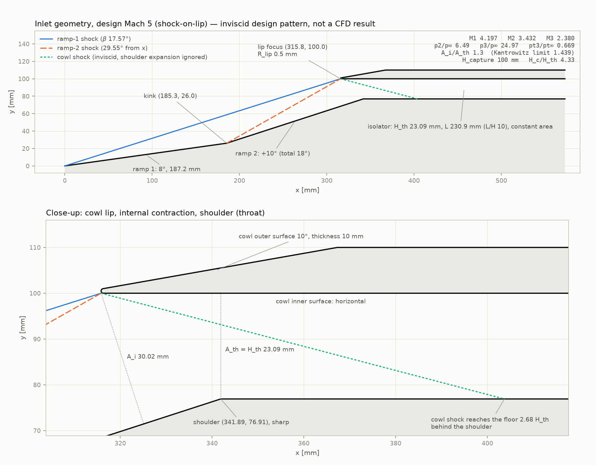
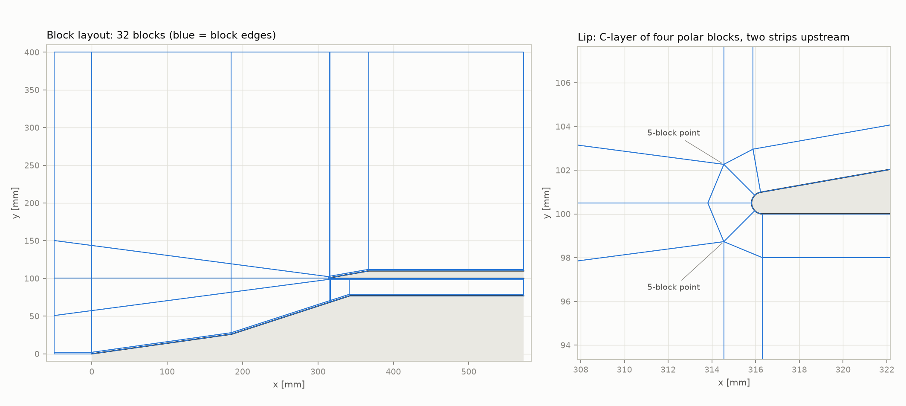
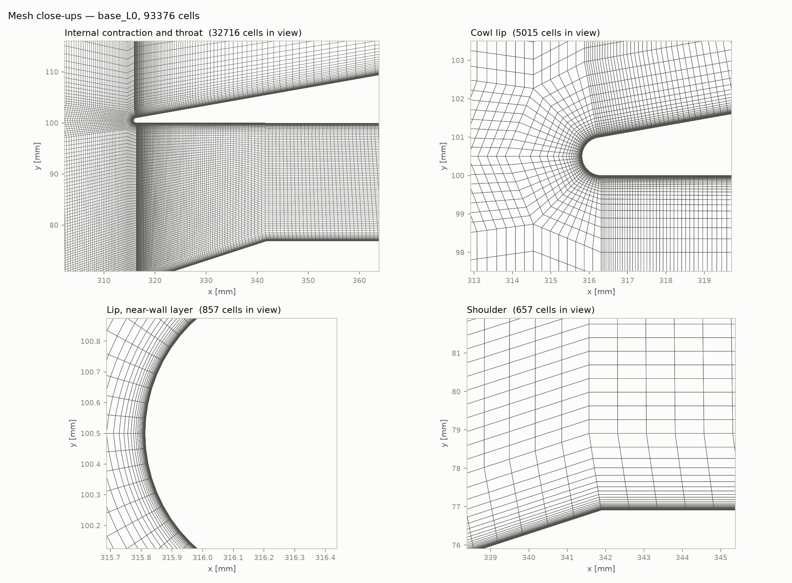

# I5 — 형상·격자 생성기 (2026-11-11)

브랜치 `i5-geometry`(작업 트리 `~/ramjet-i5`). 형상 변수와 근거는 `docs/decisions.md` D-016.
여기 적은 유동 수치는 **비점성 설계 계산**이다. CFD 결과가 아니다(§5 스모크 제외, 스모크도 결과로 쓰지 않는다).

## 1. 형상

| 항목 | 값 |
|---|---|
| 설계 마하(shock-on-lip) | 5.0 |
| 램프 | δ1 8°(길이 187.2 mm), δ2 +10°(누적 18°). 등강도 δ2는 9.48° |
| 꺾임점 / 립 초점 / 어깨 | (185.35, 26.05) / (315.81, 100.00) / (341.89, 76.91) mm |
| 카울 | 내면 수평(y = 100 mm), 립 반경 0.5 mm, 외각 10°, 두께 10 mm |
| 내부 수축 | A_i 30.02 mm, H_th 23.09 mm, A_i/A_th 1.30. 전체 수축 H_c/H_th 4.33 |
| 아이솔레이터 | 등단면, 길이 230.9 mm(L/H_th 10), 출구 x 572.8 mm |
| 설계점(비점성) | M1 4.197, M2 3.432, p2/p∞ 6.49, 카울 충격파 β 32.72°·정압비 3.85, M3 2.380, p3/p∞ 24.97, 전압비 0.669 |
| 시동 한계(A_i/A_th) | Kantrowitz 1.439, 등엔트로피 6.37, shock-on-shoulder에 필요한 값 2.13 |
| 탈착 경계(최소 M∞) | 램프 1: 1.348, 램프 2: 1.698, 수평 카울: 2.438 |
| Kantrowitz 시동 경계 | M∞ 3.34 (A_i/A_th 1.30 기준) |

A_i는 립 초점에서 2단 램프면까지의 수직 거리다(D-016). Kantrowitz 한계는 비점성·준1차원 값이라 경계층이 있는 2D 계산의 시동 경계와 같다고 보지 않는다(I8에서 비교).

### 잠정 궤적에서의 설계점 밖 상태 (비점성, 동압 50 kPa·US 표준대기 1976)

궤적은 첫 셀 높이 산정용 잠정값이다(확정은 I7). M 0.6·0.8은 해면에서도 50 kPa가 안 되어 해면 조건으로 잘랐다.

| M∞ | 고도 (km) | p∞ (Pa) | T∞ (K) | q (kPa) | Re/m | 카울 입구 M2 | 카울 뒤 M3 | p3/p∞ | 립 위치에서 1단 충격파 높이 (mm) | 그 M2의 Kantrowitz 한계 A_i/A_th |
|---|---|---|---|---|---|---|---|---|---|---|
| 0.6 | 0.00 | 101325 | 288.1 | 25.5 | 1.40e7 | — | — | — | — | — |
| 0.8 | 0.00 | 101325 | 288.1 | 45.4 | 1.86e7 | — | — | — | — | — |
| 0.95 | 2.04 | 79145 | 274.9 | 50.0 | 1.84e7 | — | — | — | — | — |
| 1.1 | 4.33 | 59032 | 260.0 | 50.0 | 1.70e7 | 탈착 | — | — | — | — |
| 1.5 | 8.78 | 31746 | 231.1 | 50.0 | 1.46e7 | 탈착(램프 2) | — | — | 412.6 | — |
| 2 | 12.50 | 17857 | 216.7 | 50.0 | 1.19e7 | 1.362 | 탈착 | — | 239.8 | 1.059 |
| 2.5 | 15.33 | 11429 | 216.7 | 50.0 | 9.54e6 | 1.795 | 1.068 | 7.43 | 182.4 | 1.168 |
| 3 | 17.65 | 7937 | 216.7 | 50.0 | 7.95e6 | 2.174 | 1.474 | 9.04 | 151.4 | 1.254 |
| 4 | 21.30 | 4464 | 217.9 | 50.0 | 5.91e6 | 2.847 | 1.995 | 15.22 | 117.9 | 1.370 |
| 5 | 24.16 | 2857 | 220.8 | 50.0 | 4.65e6 | 3.432 | 2.380 | 24.97 | 100.0 | 1.439 |
| 6 | 26.53 | 1984 | 223.2 | 50.0 | 3.82e6 | 3.941 | 2.680 | 39.22 | 88.9 | 1.483 |
| 7 | 28.56 | 1458 | 225.2 | 50.0 | 3.23e6 | 4.384 | 2.917 | 59.00 | 81.5 | 1.512 |

읽는 법: 립 높이는 100 mm다. M 4 이하는 1단 충격파가 립 위로 지나가 유출이 생기고, M 6·7은 카울 안으로 들어온다. 마지막 열이 1.30보다 작은 M∞ ≤ 3은 Kantrowitz 기준으로 자기 시동하지 않는다.

## 2. 격자

- blockMesh 32블록, 정점 48개. 립 둘레는 극좌표 블록 4개로 된 C형 층(두께 2 mm), 벽면 층 2 mm, 나머지는 H형. 5블록이 만나는 점은 립 앞 두 곳뿐이다.
- 벽 첫 셀 높이는 모서리별 등급으로 벽을 따라 일정하다. 단계 k는 셀 수를 방향당 2^(k/2)배로 늘리고 모든 셀 크기를 같은 비로 줄인다.
- 패치: `inlet`, `top`, `outlet_ext`, `outlet_duct`, `sym`, 벽 `ramp`, `floor`, `cowl_in`, `lip`, `cowl_out`.

| 단계 | 셀 수 | 첫 셀 높이 벽 / 립 (µm) | 벽면 층 셀 수·성장비 | C형 층 셀 수·성장비 | 립 45°당 셀 | 립 접선 셀 (µm) | 목·출구 흐름 방향 셀 (mm) | 아이솔레이터 흐름 방향 셀 수 |
|---|---|---|---|---|---|---|---|---|
| L0 | 93,376 | 0.80 / 0.30 | 32 · 1.218 | 37 · 1.217 | 8 | 49.1 | 0.74 / 1.05 | 261 |
| L1 | 185,789 | 0.57 / 0.21 | 45 · 1.150 | 52 · 1.150 | 11 | 35.7 | 0.52 / 0.74 | 369 |
| L2 | 374,100 | 0.40 / 0.15 | 64 · 1.102 | 74 · 1.103 | 16 | 24.5 | 0.37 / 0.53 | 522 |

알아 둘 점:
1. **checkMesh는 "Mesh OK"가 아니다.** 종횡비 검사 하나가 실패한다(최대 약 8,600, 한계 1,000). 벽 첫 셀 0.8 µm에 흐름 방향 셀 mm 단위라서 생기며 I4 격자도 같은 검사 하나가 실패한다(램프 L0 최대 44,699). 계획에 적은 "Mesh OK" 기준을 "종횡비 외 실패 검사 없음"으로 바꿔 판정했다.
2. 립 극좌표 블록은 바깥 변이 현이라 블록 가운데에서 층이 얇다. 립 첫 셀 높이가 목표보다 **최대 9.5 % 작다**(크지는 않다).
3. 립 접선 셀(49 µm, L0)은 카울 안팎 면으로 끊김 없이 이어진다. 대신 극좌표 블록 특유의 크기 차이(5배)가 C형 층 바깥 변과 립 아래 램프면(x ≈ 317 mm)에 있다.
4. 비직교 최대 27.5°는 립 위쪽 극좌표 블록 바깥(현이 27.5° 기울어진 곳)이다. 벽 인접 셀이 아니다.
5. 램프 앞전은 날카롭다. 앞전 근처 열유속은 특이점이므로 I11a 정점 판정에서 뺀다.

## 3. 성공 기준 ① 매개변수 하나로 재생성 — 통과

`python -s scripts/i5_mesh.py --out <dir> --level k --set <이름>=<값>` 한 줄로 형상·블록·등급이 전부 다시 계산된다.
아래는 `scripts/i5_regen_check.py`가 매개변수를 **하나씩만** 바꿔 blockMesh·checkMesh까지 돌린 결과다.
판정 기준(실행 전 고정, 위 1번의 수정 포함): 비직교 최대 < 60°, 왜도 최대 < 4, 음수 체적 0, 종횡비 외 실패 검사 없음.

<!-- I5_regen.md 내용 -->
| 바꾼 매개변수 | 단계 | 셀 수 | H_th (mm) | 비직교 최대/평균 (°) | 왜도 최대 | 종횡비 최대 | 실패한 검사 | 생성 시간 (s) | 판정 |
|---|---|---|---|---|---|---|---|---|---|
| base L0 | 0 | 93376 | 23.09 | 27.5 / 8.8 | 0.69 | 8642 | 종횡비만 | 3.0 | 통과 |
| level 1 | 1 | 185789 | 23.09 | 27.5 / 8.8 | 0.70 | 8959 | 종횡비만 | 7.2 | 통과 |
| level 2 | 2 | 374100 | 23.09 | 27.5 / 8.8 | 0.74 | 8795 | 종횡비만 | 18.9 | 통과 |
| cr_int 1.15 | 0 | 93338 | 26.10 | 35.4 / 11.1 | 0.69 | 8642 | 종횡비만 | 3.4 | 통과 |
| cr_int 1.44 | 0 | 93443 | 20.84 | 27.5 / 8.4 | 0.69 | 8642 | 종횡비만 | 3.2 | 통과 |
| delta2 8 | 0 | 100770 | 25.56 | 27.5 / 7.9 | 0.73 | 8642 | 종횡비만 | 3.1 | 통과 |
| delta2 12 | 0 | 87607 | 21.10 | 27.5 / 9.8 | 0.66 | 8642 | 종횡비만 | 2.9 | 통과 |
| L_iso/H 5 | 0 | 74537 | 23.09 | 27.5 / 8.2 | 0.69 | 8642 | 종횡비만 | 2.6 | 통과 |
| L_iso/H 15 | 0 | 112167 | 23.09 | 30.1 / 11.1 | 0.69 | 8642 | 종횡비만 | 3.6 | 통과 |
| lip R 0.25 mm | 0 | 98377 | 23.09 | 27.5 / 8.6 | 0.77 | 8642 | 종횡비만 | 3.1 | 통과 |
| lip R 1.0 mm | 0 | 87943 | 23.09 | 27.5 / 9.2 | 0.58 | 8642 | 종횡비만 | 2.8 | 통과 |
| M_design 4.5 | 0 | 97303 | 25.74 | 27.5 / 8.8 | 0.74 | 8642 | 종횡비만 | 3.1 | 통과 |
| M_design 6 | 0 | 87389 | 18.93 | 27.5 / 8.8 | 0.59 | 8642 | 종횡비만 | 3.1 | 통과 |

13건 모두 통과. 시험한 범위 밖(예: A_i/A_th ≤ 1.051, 립 반경 > 2 mm)은 생성기가 오류를 내고 멈춘다.

## 4. 검증(pytest)

전체 159개 통과(I5에서 74개 추가).
- 형상 설계: 립 초점이 두 충격파 위에 있음. Science 표(`docs/i5/oblique_M5_two_ramp.csv` 32행, `detach_mach_two_ramp.csv` 7행)와 독립 구현끼리 전 항목 일치(표의 마지막 자리 반올림 이내). A_i/A_th가 입력값과 일치.
- 시동 한계: `docs/exercises.md` 문제 4의 Kantrowitz·등엔트로피 값(M 2, 4, 6), 두 식의 일치, M → ∞ 극한 0.600.
- 표준대기: 층 경계값(0, 11, 20, 32 km), 문제 1의 25 km 값.
- 격자 작성기: 등비수열 합·첫 셀, 위상 오류 6종 검출, 면 방향.
- 통합 시험: 실제 blockMesh 격자에서 벽 첫 셀 높이를 다시 읽어 목표와 비교(램프·바닥 2 % 이내, 립은 위 2번 범위).

## 5. 스모크 — **미완료** (기능 확인 300회만 수행)

계획한 M5·M7 각 3,000회 스모크는 아직 돌리지 않았다. 아래는 L0, M5, np 2, 300회 기능 확인(`cases/runs/i5_smoke_short`, 커밋하지 않는 임시 케이스)이다. 수렴 전 과도 상태라 수치는 결과가 아니다.

- 설정: I4 승인값 그대로(D-016). M 5, p∞ 2857 Pa, T∞ 220.8 K, Re/m 4.65e6, 벽 300 K.
- 완주(rc 0), NaN 없음. 300회 265 s(0.88 s/회, 램프 L0와 동시 실행), 프로세스당 최대 메모리 267 MB.
- `bounding omega` 193회, `bounding k` 매 반복(I4와 같은 문구).
- 250회 시점 온도 최댓값 1,691 K로 정체온도 1,325 K보다 높다 → 장이 아직 자리 잡지 않았다.
- 250회 시점 y+ 최댓값: ramp 0.30, **floor 2.35**(x = 0.408 m, 비점성 카울 충격파 충돌 예상점 0.404 m 부근), cowl_in 0.60, **lip 1.02**, cowl_out 0.13.
  바닥과 립이 y+ < 1을 넘는다. 과도 상태 값이라 첫 셀 높이 판정은 3,000회 스모크 뒤에 한다. 그때도 넘으면 `--mesh-set dy_wall=… dy_lip=…`로 줄여 재생성한다(바닥은 약 1/3, 립은 약간).

